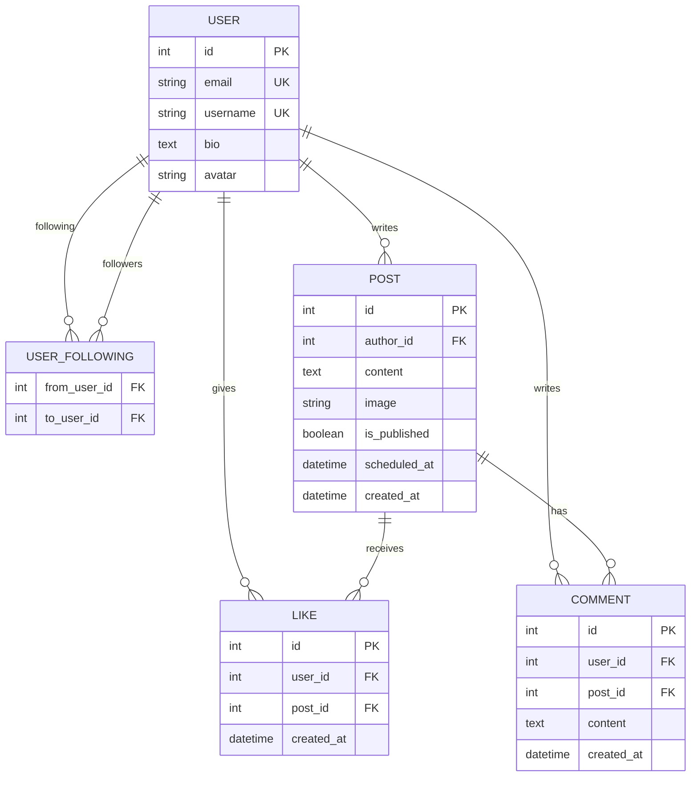

# Social Media API


[](https://www.django-rest-framework.org/)

[](https://www.docker.com/)


A production-ready RESTful API for a social media platform built with **Django**, **Django REST Framework**, **Celery**, **Redis**, and **Docker**.

---

## Key Features

- **Custom Authentication:** Email-based registration and login using DRF Token authentication with server-side token invalidation on logout.
- **User Profiles & Search:** Full profile management (`GET`, `PATCH`, `DELETE` own profile with avatar uploads) and user search by username, email, or name.
- **Follow System:** Asymmetric follow/unfollow relationships with dedicated endpoints for viewing followers and following lists.
- **Posts & Personalized Feed:** Create posts with text and optional images; retrieve a chronological feed of own posts and followed users' posts; filter by `#hashtags` or author.
- **Likes & Comments:** Like/unlike posts, view liked posts history, and manage comments.
- **Scheduled Publishing:** Schedule future post publication asynchronously via **Celery** and **Redis**.
- **Granular Permissions:** Object-level access control (`IsOwnerOrReadOnly`) ensuring users can only modify or delete their own profiles, posts, and comments.
- **Interactive Documentation:** Auto-generated OpenAPI 3 schema with **Swagger UI** and **ReDoc** (`drf-spectacular`).
- **CI/CD Pipeline:** Automated linting (`Ruff`), migration checks, and unit test execution with a 70%+ coverage gate via **GitHub Actions**.

---

## Tech Stack

- **Backend:** Python 3.12, Django, Django REST Framework
- **Asynchronous Tasks & Broker:** Celery, Redis
- **Documentation:** drf-spectacular (OpenAPI 3 / Swagger / ReDoc)
- **Containerization:** Docker, Docker Compose
- **Testing & Code Quality:** `APITestCase`, `coverage` (96%), `Ruff`, GitHub Actions

---

## Project Structure

```text
social_media_api/
├── .github/workflows/   # GitHub Actions CI pipeline
├── social_media_api/    # Project settings, root URLs, and Celery config
├── user/                # Custom User model, auth, profiles, and follow system
├── social/              # Posts, hashtag parsing, likes, comments, and Celery tasks
├── Dockerfile
├── docker-compose.yml
├── pyproject.toml       # Ruff linter configuration
└── requirements.txt
```

---

## Database Schema



---

## API Endpoints Overview

| Category | Method | Endpoint | Description |
| :--- | :--- | :--- | :--- |
| **Auth** | `POST` | `/api/users/register/` | Register a new user account |
| **Auth** | `POST` | `/api/users/login/` | Authenticate and obtain a DRF token |
| **Auth** | `POST` | `/api/users/logout/` | Invalidate current auth token |
| **Users** | `GET / PATCH / DELETE` | `/api/users/me/` | Retrieve, update, or delete own profile |
| **Users** | `GET` | `/api/users/?search=...` | List and search users |
| **Follows** | `POST` | `/api/users/{id}/follow/` | Follow a user (`unfollow/` to unfollow) |
| **Follows** | `GET` | `/api/users/following/` | List followed users (`followers/` for followers) |
| **Posts** | `GET / POST` | `/api/social/posts/` | Retrieve feed or create/schedule a post |
| **Posts** | `GET` | `/api/social/posts/?hashtag=...` | Filter feed posts by hashtag |
| **Posts** | `GET` | `/api/social/posts/scheduled/` | View own scheduled (unpublished) posts |
| **Likes** | `POST` | `/api/social/posts/{id}/like/` | Like a post (`unlike/` to remove like) |
| **Likes** | `GET` | `/api/social/posts/liked/` | List posts liked by current user |
| **Comments** | `GET / POST` | `/api/social/posts/{id}/comments/` | List or add comments on a post |

---

## Quick Start

### Option 1: Run with Docker (Recommended)

1. Clone the repository:
   ```bash
   git clone https://github.com/agridenko/social_media_api.git
   cd social_media_api
   ```

2. Build and start the services (Django, Redis, Celery worker):
   ```bash
   docker compose up --build
   ```

3. Open the interactive API documentation:
   - **Swagger UI:** `http://127.0.0.1:8000/api/docs/swagger/`
   - **Admin Panel:** `http://127.0.0.1:8000/admin/`

### Option 2: Run Locally

1. Create and activate a virtual environment:
   ```bash
   python3 -m venv venv
   source venv/bin/activate
   pip install -r requirements.txt
   ```

2. Run migrations and start the development server:
   ```bash
   python manage.py migrate
   python manage.py runserver
   ```

3. *(Optional)* Start Redis and Celery worker in separate terminals for scheduled posts:
   ```bash
   redis-server
   celery -A social_media_api worker --loglevel=info
   ```

---

## Running Tests & Linter

Run the test suite with coverage report:
```bash
coverage run --source='user,social' manage.py test
coverage report -m
```

Check code formatting and style with Ruff:
```bash
ruff check .
```

---

## License

This project is licensed under the MIT License — see the [LICENSE](LICENSE) file for details.
EOF
